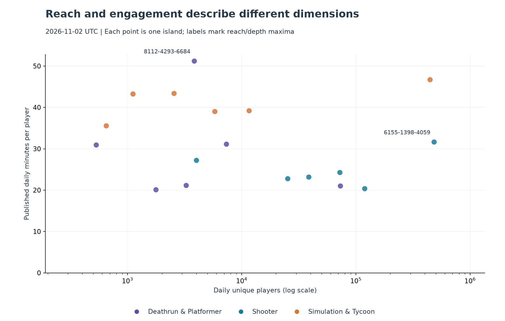

# Game Analytics

A reproducible Python and SQL pipeline for analyzing engagement across Fortnite
islands using the [official Fortnite Data API](https://api.fortnite.com/ecosystem/v1/docs/).
It combines data collection, quality validation, a local DuckDB warehouse,
coverage monitoring, descriptive reports, and validated Power BI data exports.

## Analytical questions

- Which sampled islands reach more players?
- Which show deeper engagement through minutes and plays per player?
- How do reach and engagement evolve across islands and genres over time?

The pilot follows **18 islands across three genres**: Shooter, Simulation & Tycoon,
and Deathrun & Platformer. Membership is fixed using documented ranking positions;
this is a purposive sample, not a representative survey of Fortnite.

## Data pipeline

```text
Fortnite Data API -> archived JSON -> validation -> DuckDB -> SQL -> reports / BI tables
                                                  |
                                         coverage and provenance
```

- **Collection:** individual or batch requests, UTC periods, preserved responses,
  timeouts, and explicit HTTP/network failure reporting.
- **Warehouse:** source hashes and lineage, transactional loading, revision history,
  and idempotent ingestion of identical source content.
- **Metrics:** latest valid observations per island/day/metric, including explicit
  null revisions, with SQL measures for reach and engagement.
- **Quality:** missing values and periods remain distinct from zero; coverage
  reports expose gaps, source age, and consecutive complete days.
- **Operation:** one manual command coordinates the stages, records partial
  failures, and supports archived-batch recovery without another API request.

**Stack:** Python 3.14+, uv, HTTPX, DuckDB/SQL, Pandas, and Matplotlib.
Tests use pytest; linting and formatting use Ruff. Matplotlib is an optional
analysis dependency, separate from collection and warehouse requirements.

## Published pilot

The [initial report](reports/pilot/analysis.md) covers **October 28-November 2,
2026, UTC**: 18 islands, 108 island-days, and 972 numeric metric observations.
It compares daily reach, engagement depth, and genre trajectories with explicit
coverage and selection limitations.



The islands with the highest median reach and highest median minutes per player
were different. These are descriptive findings for the selected window, not
causal conclusions or estimates of ecosystem-wide behavior.

## Quick start

Requirements: **Python 3.14+** and [uv](https://docs.astral.sh/uv/).
From the repository root:

```powershell
uv sync --group analysis --locked
uv run --group analysis --locked python scripts/update_pipeline.py
```

The update collects the previous six complete UTC days, loads new snapshots,
checks accumulated coverage, exports BI tables, and generates an analysis.
The command makes live API requests. Raw data and the database are local and
excluded from Git; running today creates a new observation window rather than
reconstructing the published historical snapshot.

Inspect **`data/processed/latest_update.md`** for stage statuses and links to the
latest coverage report and analysis. Every update keeps its own diagnostics
under `data/processed/updates/`. The published report above remains a versioned
snapshot; operational reports are generated separately for review.

To reprocess an existing batch without querying the API:

```powershell
uv run --group analysis --locked python scripts/update_pipeline.py --batch-dir data/raw/YOUR_BATCH_DIRECTORY
```

Replace the example path with a saved batch. Use `--help` for date, history,
sample, and database options. The standalone collection, loading, and analysis
scripts remain available; see the guides below for their commands.

## Repository structure

```text
config/     Fixed sample and selection design
scripts/    Collectors, validation, warehouse loading, analysis, and updates
sql/        Schema, analytical queries, and quality checks
reports/    Published pilot report and figures
powerbi/    Power Query import and DAX measure templates
tests/      Automated tests
docs/       Methodology and operational guides
data/       Local raw data, database, exports, and run diagnostics (ignored)
```

## Verification

```powershell
uv run --locked python -m pytest -q
uv run --locked ruff check scripts tests
uv run --locked ruff format --check scripts tests
```

Tests use simulated HTTP responses, in-memory databases, and temporary files.
They cover ingestion identity, null revisions, transaction rollback, metric
formulas, sample isolation, coverage, and pipeline recovery without calling the
live API. Published pilot summaries were also reconciled against archived JSONs.

## Interpretation limits

- The API documents a rolling seven-day history and covers public, discoverable
  islands. Small audiences can produce null values; source availability can vary.
- Daily unique players cannot be summed across days or islands to obtain a
  distinct audience. Minutes per player are not average session duration.
- Published retention definitions and denominators remain unresolved for cohort
  analysis; retention does not drive the primary findings.
- Genre groups can overlap. Ranking-based selection and retrospective periods
  introduce bias, and six days do not establish sustained growth or seasonality.
- The source does not provide individual player journeys, revenue, or acquisition
  costs; individual churn, LTV, and ROAS are outside this project's scope.

## Documentation

| Topic | Guide |
|---|---|
| Questions and metric definitions | [Project brief](docs/project-brief.md), [data dictionary](docs/data-dictionary.md) |
| Sample design and selection bias | [Sampling protocol](docs/sampling.md) |
| Collection, updates, and recovery | [Batch collection](docs/collection.md), [manual updates](docs/updates.md) |
| Model, revision policy, and SQL | [DuckDB warehouse](docs/warehouse.md) |
| Comparisons, eligibility, and outputs | [Descriptive analysis](docs/analysis.md) |
| BI tables, import queries, and relationships | [Power BI data package](docs/power-bi.md) |

## Power BI data exports

The manual update includes BI export. To export an existing warehouse separately:

```powershell
uv run --locked python scripts/export_bi.py
```

The latest complete package is resolved through `data/processed/bi/latest.json`.
Import instructions and measure templates are in the BI guide above; a `.pbix`
dashboard has not yet been created.

## Next milestones

Extend the fixed sample's archived history toward the proposed 28-day window,
validate the supplied import/measure templates in Power BI Desktop, and build
the dashboard. Collection is currently triggered manually.

## License

The project code is available under the [MIT License](LICENSE).
