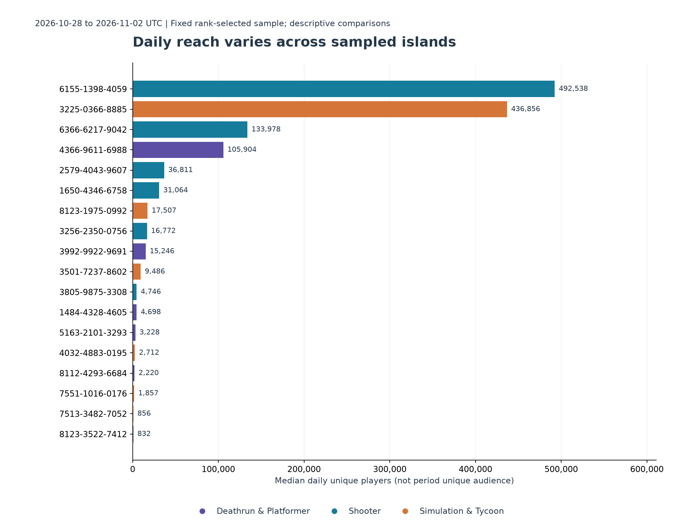
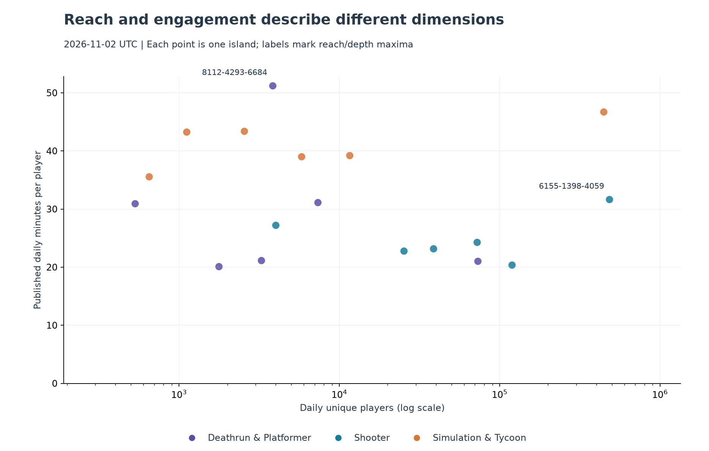
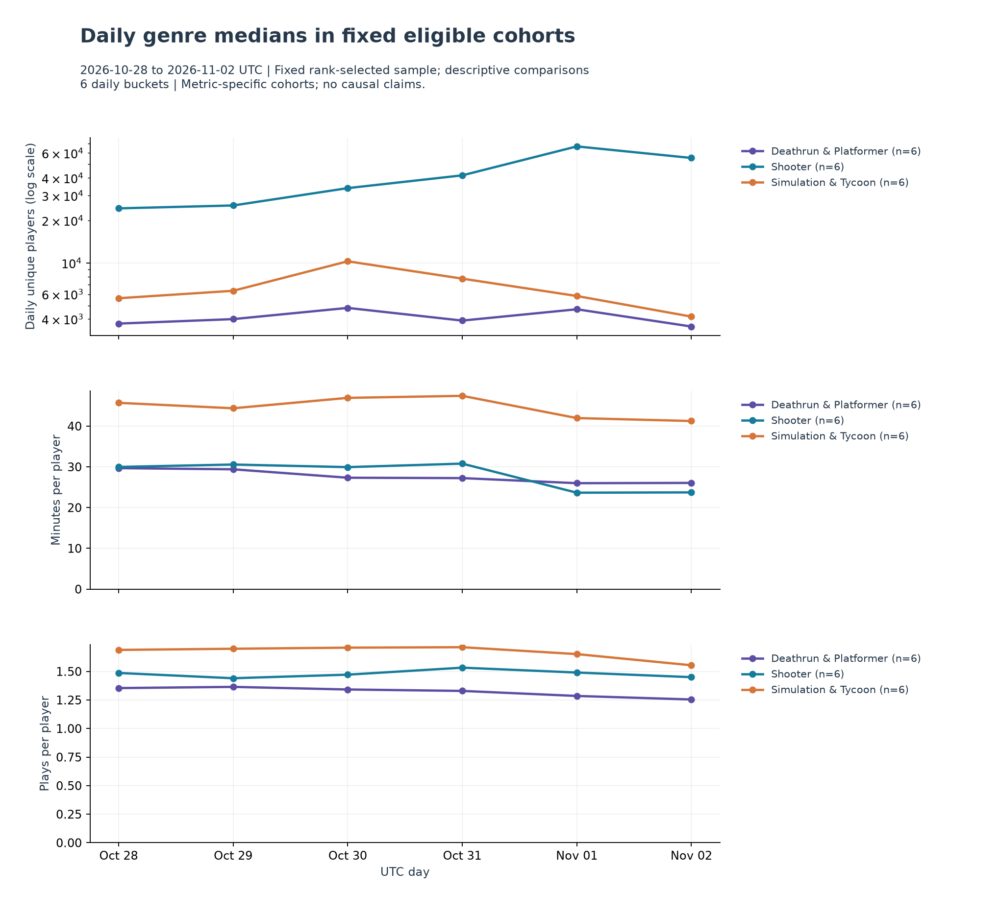

# Fortnite island engagement: pilot analysis

Observation window: **2026-10-28 to 2026-11-02, UTC**. Generated: 2026-11-03T19:42:34.466213+00:00.

## Scope and coverage

The fixed sample contains **18 distinct islands** across **3 genres**, with **6 daily buckets**. The expected grid has **108 island-days**; **108** have warehouse observations.

Across the nine metric series: **972 numeric values**, **0 explicit nulls**, and **0 absent observations**. This reflects the current warehouse view, not necessarily the newest raw file's coverage.

Only islands with numeric data on every requested day enter each metric's period comparison. Missing days and nulls are not zeros. A zero player denominator makes plays/player unavailable. Eligible cohorts are fixed over the window separately for each metric.

## 1. Which sampled islands reach more players?

Island **6155-1398-4059** has the largest median daily audience among eligible sampled islands: **492,537.50 players/day**. This is a median of daily unique counts, not unique audience across the window.

## 2. Which islands show deeper engagement?

Island **8112-4293-6684** has the largest median published daily minutes/player: **74.38 minutes**. This is not average session duration and does not establish product superiority.

The scatter plot compares reach and minutes/player on **2026-11-02 UTC**. It includes only that day's valid paired observations; zero reach is retained using a linear x-axis when present. Genre colors describe sample membership, not a causal explanation.

### Genre benchmarks

Each entry below is the median across islands' full-window daily medians. It gives each eligible island equal weight, not each player. Multi-genre islands can appear in more than one group; groups must not be summed.

| Genre | Sampled islands | Eligible reach / depth / plays | Median daily players | Minutes/player | Plays/player |
|---|---:|---|---:|---:|---:|
| Deathrun & Platformer | 6 | 6 / 6 / 6 | 3,963.00 | 27.94 | 1.31 |
| Shooter | 6 | 6 / 6 / 6 | 33,937.50 | 29.96 | 1.48 |
| Simulation & Tycoon | 6 | 6 / 6 / 6 | 6,099.00 | 44.70 | 1.68 |

## 3. How do reach and engagement change?

The lines show daily medians across each genre's metric-specific complete-window cohort. A difference between genre medians is a description of this selected sample. The cohort size appears in each panel legend; this is not an estimate for all Fortnite islands.

The largest absolute first-to-last reach change among eligible islands is **251.91%**, for **3256-2350-0756**: **10,982.00** players on the first day and **38,647.00** on the last. This compares endpoints, not a fitted trend, and does not imply the path was monotonic.

## Interpretation limits and next decisions

- The sample is purposive: six selected positions within each genre's top-100 frame. Ranking positions are not verified audience strata.
- No causal claims about design, promotion, ranking exposure or calendar events are supported. A high reach rank need not imply stronger engagement.
- The 6-day window is descriptive. No seasonality model, significance tests or predictive validation are included; sustained growth is not established.
- Retention definitions and denominators remain unresolved, so retention does not drive these findings. Favorites/recommendation rates remain deferred.
- Coverage is based on latest valid observations per metric; omitted newer fields may leave an older value current. Source timestamps and hashes are exported for staleness review.
- Preserve the fixed sample and extend collection across the proposed 28-day window before making durable product recommendations. Review within-genre trajectories and coverage before dashboard publication.
- This window includes dates preceding the ranking snapshot used for selection. Those historical comparisons are conditioned on later ranking membership; they are not an unbiased prospective evaluation.

## Reproducibility

Run `uv run --group analysis python scripts/analyze_sample.py` after warehouse loading. Defaults infer the available window for the selected sample; use explicit dates for a fixed comparison. SQL: `sql/sample_analysis.sql`. Full input identifiers, metric coverage, island summaries, daily genre medians and metric provenance are exported under `data/processed/analysis/` by default. No new API request is made.

Sample SHA-256: `216540c40c58bd0114645781aabf01499acde1b920d1bd7a6a76240d6c023f44`.

Database SHA-256 at generation: `9b41865101257045997c1500d34afc5a2deb42407ab7edde150d2f6193dcdc6c`.
